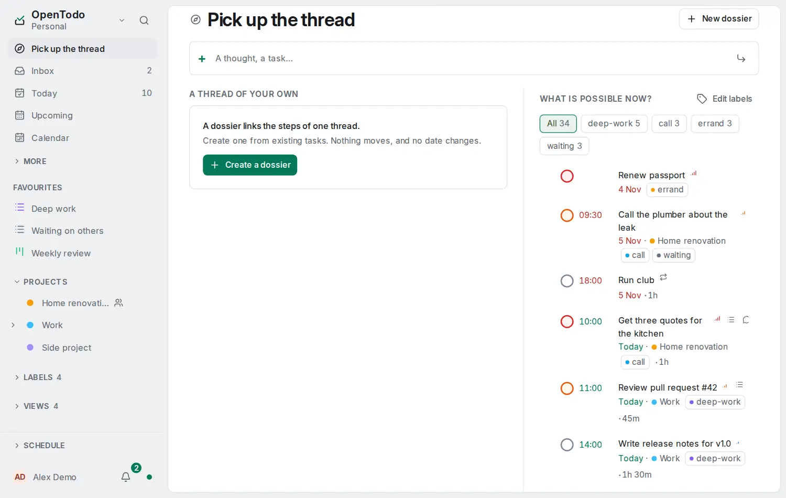

# Pick up the thread

<picture><source srcset="images/resume-page-dark.webp" media="(prefers-color-scheme: dark)"></picture>

A dossier links tasks you already have, in the order you choose, so a piece of work spread over several lists reads as one thread. The tasks stay in their lists: a dossier never moves them, dates them or completes them.

## Make a dossier

- **New dossier** on **Pick up the thread**, then add tasks to it. Or, from a task's menu, **Add to a dossier** adds it to a dossier or starts one with it.
- The dossier's next step is its first open task. A completed task stays in the thread; reopening one makes it the current step again.
- Removing a task from a dossier keeps the task. Deleting a dossier keeps its tasks.
- A dossier is yours alone. A task that was deleted or that you can no longer see is shown as unavailable.

## Wait and come back

- Put a dossier on hold to say what you are waiting for and, if you like, when to look again. That follow-up date belongs to the dossier: it never sets a due date and sends no reminder.
- **Not now** on the featured dossier holds it until tomorrow.
- Held dossiers also show in **Waiting**. **The wait is resolved** clears the hold, and the next open task is the step again.
- Every change to a dossier can be undone.

## My day

The sun adds a dossier to today's focus, whatever its tasks' dates. Its next step then counts as planned for today, under **My day** on [Today](today-and-upcoming.md).

## Linking as you add

When a task you add looks like one of your dossiers (its name, its note or its tasks), the app offers to link it. The comparison runs on your device and sends nothing anywhere. The task is added either way, and it joins the dossier only if you accept.
