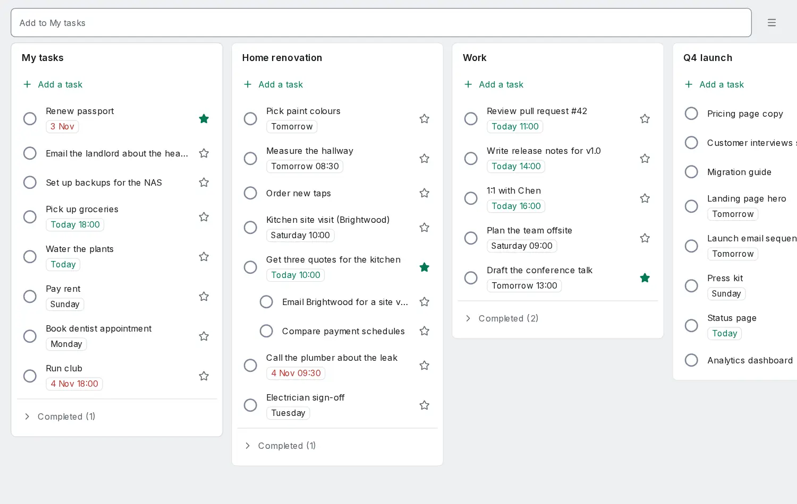

# Simple mode

<picture><source srcset="images/simple-board-dark.webp" media="(prefers-color-scheme: dark)"></picture>

Simple mode is one screen: your lists side by side, each task on one line with a star, and one field at the top. Everything else stays in the full app, and every task is the same task there.

## Turn it on

- **Settings → General → Simple mode**, or run **Simple mode** from the command bar (`Ctrl+K`).
- The app then opens on `/simple` on all your devices. Every other page still opens by its address.
- To go back, choose **All features** from the menu at the top right. Nothing you set up in the full app changes either way.

## Lists

- **My tasks** comes first: every open task without a project, dated or not. It is not the Inbox, which leaves out scheduled tasks.
- Then each project, in sidebar order. Uncheck a list in the menu to hide it here; it stays in the full app. **New list** creates a project.
- A project's sections are shown one after the other, without their names.
- Each list ends with **Completed (n)**. Open it to reopen a task.
- Below 768 px wide one list is shown at a time, with the lists as tabs. Swipe sideways to change list. The phone remembers the last one.

## Tasks

- The circle completes a task, with Undo. The star marks it: a starred task has priority 1, and removing the star sets priority 4. A task with priority 2 or 3 from the full app shows no star and keeps its priority.
- Drag a task to reorder it or to move it to another list. Moving it to another list clears its section.
- Select a title to edit the task: title, notes, date, star, list and subtasks. **Open in full app** opens it there, and Simple mode stays on.
- Subtasks show under their task. A subtask with subtasks of its own shows how many.

## The field

- **Enter** adds the line as a task, read like [quick add](quick-add.md): a date, `!1` or `#List` work as usual. Without a `#List` the task goes to the selected list, else to My tasks.
- **Ctrl+Enter** (**⌘+Enter** on a Mac) or **Ask** sends the line to the [assistant](assistant.md). Its proposals open for review, and nothing changes until you apply them.
- The sparkles menu runs four actions: **Plan my day** proposes 3 to 5 tasks for today, **Break this down** splits the selected task (or the line), **Turn this into tasks** makes tasks of the line and files each with a list when one list's tasks clearly share its subject, and **Tidy up** proposes to complete duplicates and park tasks untouched for 60 days in Someday.
- Without the assistant, or on an encrypted account without the [on-device assistant](assistant-encrypted.md), there is no Ask and no sparkles menu, and Ctrl+Enter adds like Enter. Adding works offline; asking needs a connection unless the assistant runs on the device.

## Keys

`/` the field · `j` `k` the next or previous task · `h` `l` the previous or next list · `x` complete · `s` star · `Enter` edit · `n` add to the selected list · `Alt+↑` `Alt+↓` move the task · `Alt+←` `Alt+→` move it to the next list.

## Coming from Google Tasks

Import your Takeout file first ([Switch from Google Tasks](switch/google-tasks.md)), then turn on Simple mode: your lists become the columns, and My Tasks becomes My tasks.
